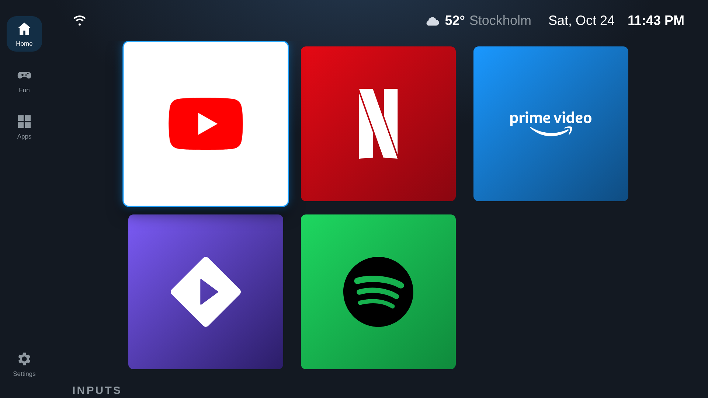
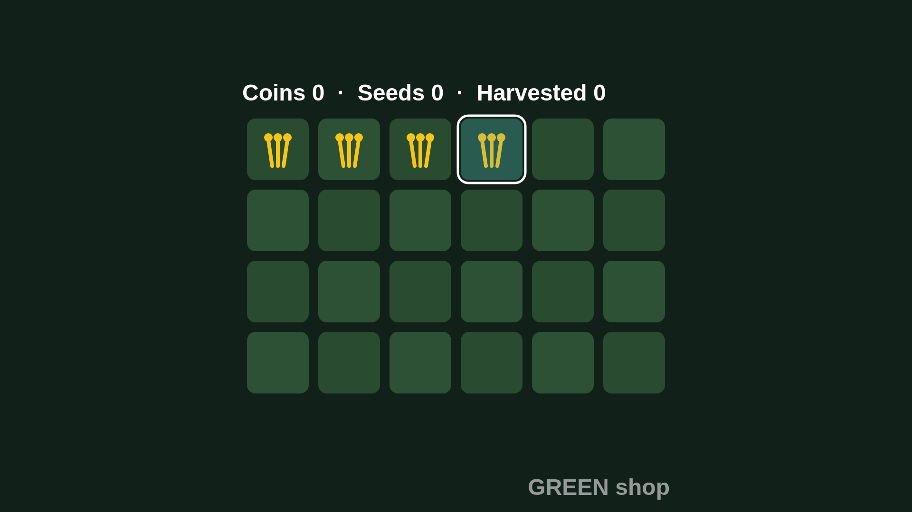
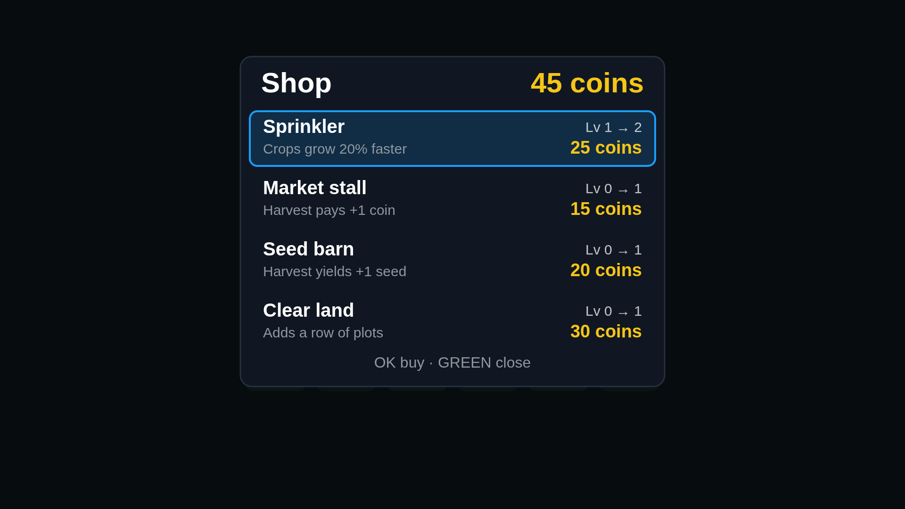
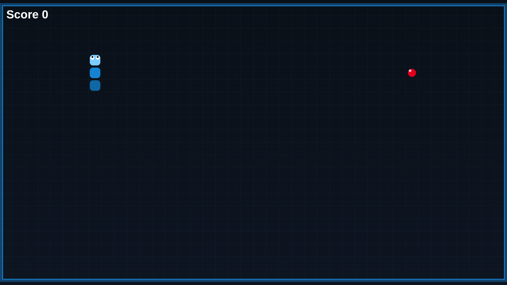
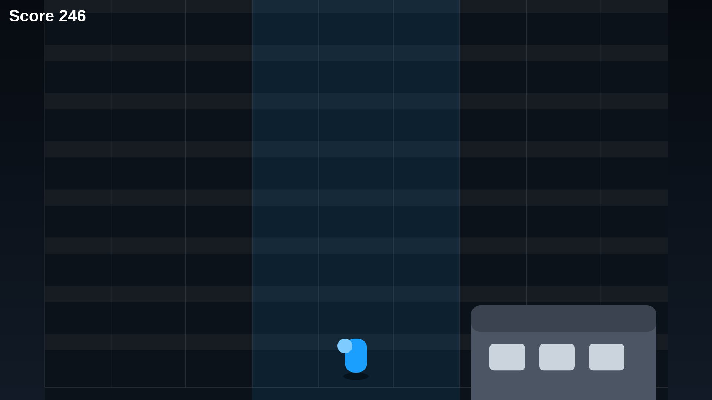
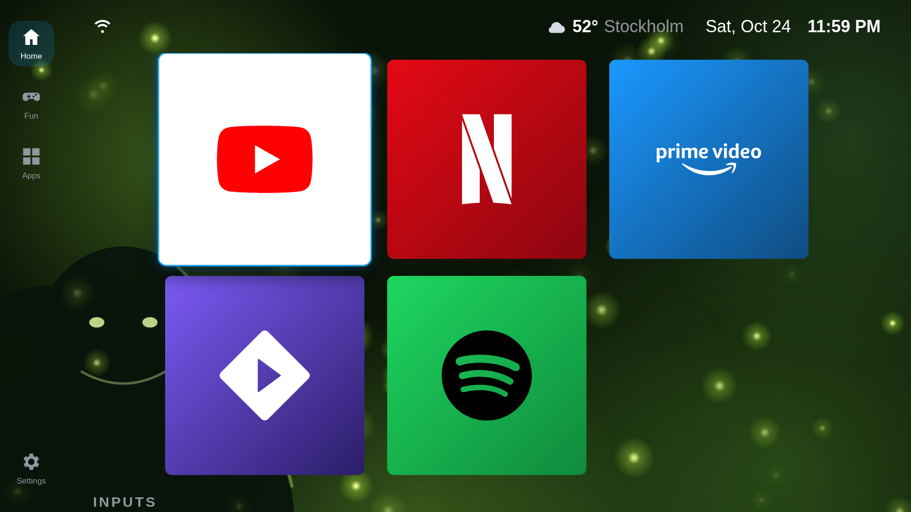

# SteamTizen

[](https://github.com/SompLy/SteamTizen/actions/workflows/ci.yml)
[](https://github.com/SompLy/SteamTizen/releases)
[](LICENSE)

**A Steam-OS-style home screen for Samsung Tizen TVs — with a fireplace and actual games.**

A normal TV app that acts as your home screen: it opens at power-on, comes back when you press
Home, and pairs a command-line tool that sets it all up from your computer — no Tizen Studio,
no root.



## Home screen

- Your apps as square cards using each app's own artwork from the TV. **Big** (3 across) or
  **Small** (5 across) cards; apps without artwork show their icon and name
- **Home**, **Fun** and **Apps** tabs: favourites on Home, built-in activities on Fun, every
  installed app from All apps with live search
- Hold OK on a tile to move it around; hold it in one place and drop it
- Inputs list every HDMI port and what's plugged in — rename them, hide disconnected ports
- Time, date and weather in the top bar: searched town or approximate location from your IP,
  °C/°F from your region, 12/24-hour from the TV's settings
- Ethernet/Wi-Fi indicator, optional night dimming between late hours
- Opens HbbTV apps such as BBC iPlayer; works on The Frame without touching Art Mode
- A fireplace tile: real fireplace video with sound, procedural canvas fire as offline fallback

## Built-in games

Five games run fullscreen on the remote alone — arrows to steer, OK to act, BACK to leave.
They live on the **Fun** tab next to the fireplace.

| Mini Farm | Farm shop |
|---|---|
|  |  |

**Mini Farm** — plant seeds, wait for the sprouts, harvest for coins. Harvesting returns its
seed, so the loop never dead-ends. Coins buy shop upgrades that persist between sessions:
the Sprinkler grows crops 20% faster per level, the Market stall pays +1 coin per harvest,
the Seed barn yields +1 extra seed, and Clear land adds a whole row of plots. Out of seeds?
Pressing OK on an empty plot opens the shop for you. The shop hut in the bottom-right
corner opens it anytime; leave the shop with Done or BACK.

| Snake | Lane Runner |
|---|---|
|  |  |

**Snake** — classic 40×22 board, speeds up as you eat. **Lane Runner** — 3-lane endless runner
in Subway Surfers view: lanes run away from you and obstacles bear down from down the tracks —
switch lanes, jump the crates, roll under the bars, grab the coins.

**Breakout** — arrows slide the paddle, OK serves; three balls, five brick rows, clearing
them all wins. **2048** — arrows slide the whole board, equal tiles merge once per move,
and a full board with no merges is the end; OK deals a fresh one.

## Themes

33 backgrounds, 17 of them animated, with a speed slider and live swatch previews — drifting
blobs (Aurora, Lava, Synthwave…), particles (Snowfall, Rain, Fireflies), a starfield and ocean
waves. Including a **Shrek Swamp** theme: murky swamp water, drifting slime-green blobs and
fireflies over the whole home screen.



## From your computer (`aerotizen`)

- Finds the TV on your network
- Connects to the TV's developer port directly in Python, on macOS, Linux or Windows
- Creates the Samsung signing certificates for your TV (one Samsung account sign-in)
- Signs and installs any `.wgt` app, including the launcher
- Opens apps and checks they actually came up on screen (`aerotizen launch`)
- Restarts apps with Chrome DevTools for debugging (`aerotizen inspect launcher`)
- Lists installed apps, flags the bloat, and removes it if your firmware allows

## Setup

You need a computer on the same network as the TV.

1. Grab the latest **CLI** release (`cli-v...`) from
   [Releases](https://github.com/SompLy/SteamTizen/releases) and extract it (Linux x64,
   Windows x64, or macOS). Check it finds your TV:

   ```bash
   ./aerotizen discover
   ```

2. Turn on Developer Mode on the TV: open **Apps**, type `12345` on the remote, switch it on,
   and set Host PC IP to your computer's IP. Then unplug the TV for a minute — remote-off
   isn't enough for the change to apply.

3. Create the certificates (opens Samsung's sign-in page in your browser):

   ```bash
   ./aerotizen certs
   ```

4. Install the launcher. This downloads the latest stable launcher release, checks its
   checksum and compatibility, signs it, and installs it:

   ```bash
   ./aerotizen install launcher
   ```

   Re-run the same command to update later. If you use Python 3.10+, you can instead
   `pip install git+https://github.com/SompLy/SteamTizen` and run `aerotizen` directly.

That's it — the TV starts on SteamTizen from now on; the gear icon opens settings. For
accurate weather, search for your town in **Settings → Weather**.

| Settings | Moving a tile |
|---|---|
|  |  |

## Tested on

| TV | Year | Firmware |
|---|---|---|
| Samsung 65" Crystal UHD DU7200 (UN65DU7200FXZA) | 2024 | Tizen 9.0 |
| Samsung 65" The Frame LS03D (QE65LS03DAUXXU) | 2024 | Tizen 9.0 |
| Samsung 65" OLED S90C (QE65S90CATXZT) | 2023 | Tizen 7.0 |
| Samsung 75" QLED Q60B (QE75Q60BAUXXC) | 2022 | Tizen 6.5 |

Other Samsung TVs from 2020 on should work. If you try it on yours, please
[open a model report](../../issues/new?template=model_report.yml).

## Limits

- Pressing Home brings the launcher back after a second or two — from Samsung's home screen
  and inside Netflix, but not inside YouTube, Prime Video, Stremio, Spotify or HbbTV apps
  (they don't report on-screen state). Back still works everywhere.
- On Tizen 6+, store and preinstalled apps can't be removed over the developer connection;
  delete them on the TV under Apps → Settings. System apps (TV Plus, Gaming Hub) can only be
  disabled.
- TV apps are drawn at 1920×1080 and upscaled, even on 4K panels — only video plays native 4K.
- Samsung's own menus can't be changed; see the [settings guide](docs/settings.md) and
  [DNS blocklists](dns/) for what you can switch off instead.

## Development

The launcher is plain ES5-style scripts sharing one namespace — no build step, no runtime
dependencies (dev tooling only):

```bash
npm install
npm run lint   # eslint
npm test       # node --test tests/*.test.cjs
```

The CLI is Python (`aerotizen`), tests in `tests/test_*.py`. Release flow is
[release-please](docs/releases.md); see [CONTRIBUTING.md](CONTRIBUTING.md) for how to help.

## Credits

- [LTvLauncher](https://github.com/leanbitlab-org/LtvLauncher), which the layout is based on
- [Apps2Samsung](https://github.com/Apps2Samsung/Apps2Samsung) and [tizen-sdb](https://github.com/PatrickSt1991/tizen-sdb), for how the developer connection, certificates and signing work
- [samsung-tizen-tv-debloat](https://github.com/ardazeytin/samsung-tizen-tv-debloat), for which packages are safe to remove
- Fallback logos from [Simple Icons](https://simpleicons.org). App artwork is read from
  Samsung's cache on each TV; none is bundled or downloaded. Artwork and trademarks belong
  to their owners
- Weather and location search from [Open-Meteo](https://open-meteo.com), automatic location
  from [ipapi](https://ipapi.co)

This project isn't affiliated with Samsung. Use it at your own risk.

## License

[MIT](LICENSE)
